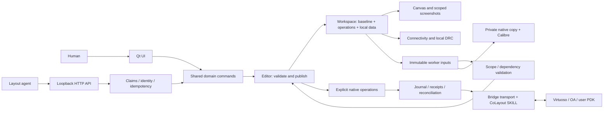

# Architecture and invariants

[中文摘要](zh/architecture.md) · [Development](development.md) · [API](api.md)

CoLayout has three external surfaces: the Windows UI, the local Agent API and the native Virtuoso adapter. They share one authoritative Workspace, Editor and object identity system. Read-only worker snapshots are not separate editable layouts.

## Data and command flow

A separate setup agent uses Bridge to collect a sample and submit a ProcessPackage through process_configuration. Only the human review UI activates it.

## Source map

| Module | Responsibility and boundary |
|---|---|
| model.py, local_models.py, circuit/ | Persistent models, native facts, local hierarchy, schematic reference |
| editor.py, actions.py, workspace_actions.py | Shared transactional commands, undo, object validation and adoption |
| regions/, frame_edit.py, human_edit.py | Construction-level operations, frame/PIN actions, human edit policy |
| work_sessions.py, scope_state.py, workspace_delta.py | Ownership, effective inputs, concurrent scoped result merging |
| document.py, workspace_storage.py, workspace_files.py | JSON encoding, internal copies/recovery, explicit external snapshots |
| geometry*, materials*, conduction*, physical_connectivity.py | Geometric evidence and supported conductive graph; no UI or network orchestration |
| drc/ | Supported local rules, report parsing, asynchronous server tasks and result evidence |
| autoroute/, layout_helpers.py | Frozen algorithm input, proposed geometry and shared composed operations |
| adapter.py, sync_checks.py, transactions.py | Source/dependency preconditions, native transaction journal and reconciliation |
| transport.py, native_lane.py, skill/ | Explicit Bridge boundary, serialized native lanes and CoLayout-owned SKILL kernel |
| workspace_app.py, studio_window.py, studio_shell.py, presentation/ | Window lifecycle, scene presentation, task callbacks and scoped read-only rendering |
| process_package.py, process_configuration.py, process_setup.py, process_agent.py | Unified PDK data, human review, sample collection and native reproduction |
| agent_tools/ | Contract, HTTP envelope, sessions, jobs, scoped inspection/edit/check/capture |
| bootstrap.py, tools/ | Portable installation, dependency verification, launch and client publication |

Search the module names rather than maintaining duplicate implementations. Geometry paths may use QtCore/QtGui without constructing widgets. Physical services must not import QtWidgets or native transports.

## Persistent state

Workspace holds a native baseline, pending local operations, local_data, schematic reference circuit and native layout_connectivity. Units inside native geometry are integer DBU; API edit coordinates are workspace-absolute micrometres unless explicitly documented otherwise. Convert with the profile's dbu_per_micron, not a fixed scale.

UIDs survive editing and refer to the same objects through UI and API. Names, displayed labels and schematic parameters are not substitutes for identity or physical net equivalence.

| Storage | Purpose |
|---|---|
| .colayout/installation.json | Local installation pointer, interpreter, document and current client root |
| config/ | Local connection and approved process settings |
| artifacts/workspace-runtime/ | Working documents, recovery backups and their locks |
| artifacts/native/ and per-task records | Native receipts and source/dependency evidence |
| Client runtime/requests/outputs/workspaces | Client identities, unresolved requests, results and explicit archives |

All are runtime data excluded from Git. External JSON archives are updated by explicit save/save-as. Opening an archive creates an internal working copy. Global load first preserves the current document and requires idle work and no unresolved native transaction. Never overwrite recovery history to make a test pass.

## Two hierarchies

Local operation regions organize a flat native design without creating OA child cells. Parent and child regions can be claimed independently. The parent owns only direct child frames, public interfaces, pose and constraints; it cannot read/edit child interiors through a parent claim. Same-level claims are exclusive. Releasing the parent does not release children. Active children cannot be dissolved.

Native hierarchy comes from imported master/instance evidence. A true hierarchical instance stays opaque except for its public PINs and object-specific routing windows. A leaf PCell or mosaic is not automatically a black box: ordinary leaf devices still participate in DRC. Use hierarchy.is_hierarchical_instance; do not infer hierarchy from cell names, library names or whether the renderer is collapsed.

Human physical edits are locked at an occupied construction level, except for the supported locator guidance actions. A region's own agent can change its frame, interfaces and mode. Parent changes to child pose/interfaces invalidate relevant child inputs. Human navigation does not grant edit rights.

## PIN and connectivity semantics

- Physical connection is established by supported material, geometry and native contacts, never by matching display names.
- A virtual interface is a boundary obligation, not generated conductive material. any_metal means one permitted layer can satisfy access; it does not create a via.
- Parent access uses the outward half of a boundary PIN, child access the inward half.
- Copies use explicit access_group. A parent can choose an exit; fixed-mode child completion still checks every required physical exit. Logical grouping must not union disconnected physical components.
- Schematic traversal follows native Layout correspondence to the needed depth. Missing access can be recorded as deferred work, not fabricated as a real native PIN.
- Visual net highlighting is intentionally a separate presentation feature; do not change it when adding a local DRC patch.

## Parallelism and performance

The Qt owner thread publishes edits serially. Expensive read/check/batch work uses bounded workers with immutable input. An accepted job is not a committed edit. Before adopting a worker result, compare the relevant construction-level fingerprint, dependencies, permissions and cancellation state. Unrelated sibling revision changes should not invalidate independent work; relevant parent changes must.

Do not call Qt widgets from workers, hold model locks while waiting for GUI callbacks, or run a nested blocking wait on the GUI thread. Qt background tests must pump a QEventLoop. Closing a dock hides it; closing its owning window disposes subscriptions, timers and task callbacks. Results must not resurrect a closed window.

Cache keys must include relevant geometry, technology and scope. Worker/canvas caches are disposable accelerators; they cannot replace validation or transaction records. Keep pixel/detail transitions stable during pan/zoom.

## Checks and completion

Local DRC is deliberately partial. Unsupported width geometry is skipped without item-by-item handoff noise. Actual local errors, incomplete evidence and exceptions cannot be turned into a pass. Direction preference, single-cut advice and non-PIN internal-metal contact are advisory warnings.

Cross-device Poly contact uses a separate temporary graph to detect conflicting native terminals; it does not change ordinary routing or highlight rules. The configured MIM check intersects independent via cuts with the actual mask geometry for the configured metal pair and excludes native PCell-internal vias. Neither algorithm is a full device extractor.

Server checks run on private copies containing the local edits. Both UI and API use the same scope and approved report_policy; raw results remain available. Filtering cannot turn failed, truncated or stale jobs into valid evidence. Server DRC can run independently; release(done) requires current full-region local and server evidence. Regional completion is not LVS or full-chip sign-off.

## Native writes and recovery

Only explicit import/sync, native generation and server checks access Virtuoso. A native transaction verifies source, dependencies and baseline; journals its request before mutation; records receipts; then verifies save/export before adopting a new baseline. Unknown results require reconciliation with the same identity. Do not clear pending, mutate transaction status, regenerate a request ID or weaken geometry checks to bypass a failure.

Temporary native cells have ownership/lease tracking. Clean only proven-owned expired artifacts and preserve uncertain transactions. Never delete an arbitrary cell just because its name resembles a temporary prefix.

## Extension rules

Put a new shared behavior in a domain service, then expose thin UI/API adapters. Add contract discovery, scoped permissions, stale-input handling and behavioral regressions together. Avoid a separate Agent workspace, physical graph or undo stack. A new PDK fact belongs in ProcessPackage with evidence and review, not a hardcoded foundry/cell/layer heuristic.
