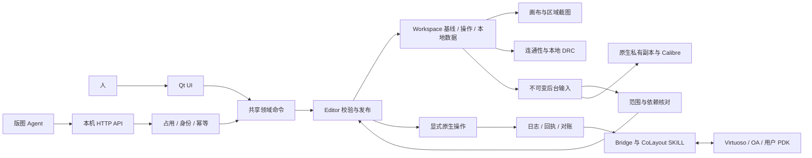

# 软件架构与维护边界

[项目首页](../../README.zh-CN.md) · [文档目录](index.md) · **简体中文** | [English](../en/architecture.md)

CoLayout 有三大对外接口：Windows UI、本机 Agent API 和 Virtuoso 通信适配器。它们共用唯一的 Workspace、Editor 和对象身份系统。后台只读快照用于计算，不是另一套可编辑版图。

## 数据与命令流

独立的初始化 Agent 使用 Bridge 采集样例，通过 process_configuration 提交 ProcessPackage。只有人端审核界面可以启用工艺配置。

## 源码模块

以下路径均相对于 colayout_lite。修改时先查找对应模块，避免重复实现共享规则。

| 模块 | 职责与边界 |
|---|---|
| model.py、local_models.py、circuit/ | 持久模型、原生事实、本地层次、原理图参考 |
| editor.py、actions.py、workspace_actions.py | 共享事务命令、撤销、对象校验和结果采用 |
| regions/、frame_edit.py、human_edit.py | 当前操作层的编辑、边界/PIN 动作、人端编辑权限 |
| work_sessions.py、scope_state.py、workspace_delta.py | 区域占用、有效输入、并发结果的范围合并 |
| document.py、workspace_storage.py、workspace_files.py | JSON 编解码、内部副本/恢复、显式外部存档 |
| geometry*、materials*、conduction*、physical_connectivity.py | 几何事实与受支持的导通图，不编排 UI 或网络访问 |
| drc/ | 本地规则、报告解析、异步服务器任务与检查证据 |
| autoroute/、layout_helpers.py | 冻结算法输入、候选几何和共享组合动作 |
| adapter.py、sync_checks.py、transactions.py | 原生源/依赖前提、事务日志和对账 |
| transport.py、native_lane.py、skill/ | Bridge 边界、原生通道串行调度、CoLayout 自有 SKILL 内核 |
| workspace_app.py、studio_window.py、studio_shell.py、presentation/ | 窗口生命周期、场景显示、任务回调和区域只读渲染 |
| process_package.py、process_configuration.py、process_setup.py、process_agent.py | 统一工艺数据、人端审核、样例采集与原生复现 |
| agent_tools/ | API 契约、HTTP、会话、任务、区域查询/编辑/检查/截图 |
| bootstrap.py、tools/ | 可迁移安装、依赖校验、启动和客户端发布 |

几何路径可以使用不创建窗口的 QtCore/QtGui。物理服务不应依赖 QtWidgets 或原生通信。

## 持久状态

Workspace 保存原生基线、待提交本地操作、local_data、原理图参考 circuit 和原生 layout_connectivity。原生几何内部使用整数 DBU；API 编辑坐标通常是工作区绝对微米，特殊接口以说明为准。必须按工艺的 dbu_per_micron 转换，不能写死比例。

UID 在编辑过程中保持稳定，UI 和 API 指向同一对象。对象名、显示标签和原理图参数都不能代替身份或物理网络等价关系。

| 位置 | 用途 |
|---|---|
| .colayout/installation.json | 本机安装指针、解释器、文档和当前客户端目录 |
| config/ | 本机连接和已审核工艺配置 |
| artifacts/workspace-runtime/ | 工作副本、恢复备份和文件锁 |
| artifacts/native/ 及任务记录 | 原生回执、源与依赖证据 |
| 客户端的 runtime/requests/outputs/workspaces | 身份、未决请求、结果和显式存档 |

以上都是不进入 Git 的运行数据。外部 JSON 仅在显式保存／另存为时更新，打开存档会建立内部工作副本。整工作区加载先保留当前文档，并要求任务空闲、没有未决原生事务。不能为通过测试覆盖恢复历史。

## 两套层次

本地操作区组织原生版图，不创建 OA 子 cell。父子区可分别接入 Agent。父只管理直接子区的外框、公开接口、位姿和约束，不能通过父会话读写子区内部。同层独占；释放父区不释放子区；活跃子区不能解散。

原生层次由导入的 master/instance 证据确定。真正层次对象保持黑盒，只开放公开 PIN 和对象专属的布线豁免。叶 PCell 或阵列不自动成为黑盒，普通叶器件仍参与 DRC。统一使用 hierarchy.is_hierarchical_instance，不按库名、cell 名或显示折叠状态猜测。

占用层的人类物理编辑被锁定，受支持的定位框指导是例外。本区 Agent 可调整自己的外框、接口和模式。父层改变子区位姿或接口会使相关子任务输入失效。人端查看不授予编辑权限。

## PIN 与连通语义

- 物理连通由受支持的材质、几何和原生接触建立，不按显示名称相同来合并。
- 虚拟接口是边界接入义务，不是实体金属。any_metal 表示某一允许层可以满足接入，不代表自动存在过孔。
- 父层使用边界 PIN 的外半边，子层使用内半边。
- 复制 PIN 使用显式 access_group。父层可以选择出口，但固定 PIN 模式下，子层仍需逐一完成要求的真实出口。逻辑分组不能合并不相连的物理分量。
- 原理图按 Layout 原生对应关系下探到需要的深度。缺少实体接入可以记录为待补事项，不能伪造原生 PIN。
- UI 的网络高亮有独立的展示语义，增加本地 DRC 补丁时不要顺便改变它。

## 并发与性能

Qt 所属线程串行发布编辑。耗时查询、检查和批量操作使用有界后台任务与不可变输入。“任务已接受”不等于“编辑已提交”。采用结果前核对相关操作层指纹、依赖、权限和取消状态。无关兄弟区的 revision 增长不应导致独立任务失效，相关父层变更则必须使旧输入失效。

后台线程不能操作 Qt 控件，不能持有模型锁等待 GUI 回调，也不能在 GUI 线程阻塞等待自身事件。后台 Qt 测试使用带超时的 QEventLoop。关闭 Dock 只是隐藏；关闭所属窗口要释放订阅、定时器和回调，任务完成不能重新唤起已关闭窗口。

缓存键必须包含相关几何、工艺和范围。画布与后台缓存仅用于加速，不能替代校验和事务证据。平移、缩放时应保持细节切换稳定，避免闪烁。

## 检查与完成验收

本地 DRC 有意只覆盖部分项目。不支持的宽度几何直接跳过，不产生逐项“未检查”记录。实际本地错误、证据不完整或异常不能当作通过。方向偏好、单孔提醒和非 PIN 内部金属接触属于建议性 warning。

跨器件 Poly 接触使用独立临时图检查原生端子冲突，不改变普通连通或高亮。MIM 检查按配置的上下金属对，检查独立过孔切孔与实际 MIM 层几何的重叠，排除原生 PCell 内部孔。两者都不进行完整器件电路提取。

服务器 DRC 使用包含本地修改的私有副本。UI、API 共用范围和人端批准的 report_policy，原始结果保留。过滤不能把失败、截断或过期结果变成有效证据。服务器检查可独立启动，release(done) 仍要求当前全区本地和服务器两类证据均通过。区域完成不等于全芯片或 LVS 签核。

## 原生写入与恢复

只有显式导入／同步、原生几何生成和服务器检查访问 Virtuoso。原生事务先核对源、依赖和基线，在修改前记录请求，保存回执，再核验保存／导出后采用新基线。结果未知时必须沿用相同身份对账，不能清 pending、改状态、换请求 ID 或放松几何核对来绕过失败。

临时原生 cell 使用所有权与租约记录。只清理已证明归本程序所有、已到期的对象，保留不确定事务。不能仅按名称前缀删除 cell。

## 扩展原则

共享行为先写入领域服务，再添加薄的 UI/API 适配层。接口发现、范围权限、过期输入处理和行为回归一起维护。不要另建 Agent 工作区、物理图或撤销栈。新增 PDK 事实放入带依据、待审核的 ProcessPackage，不写死某家工艺的器件或层名。

---

[项目首页](../../README.zh-CN.md) · [文档目录](index.md) · **简体中文** | [English](../en/architecture.md)
