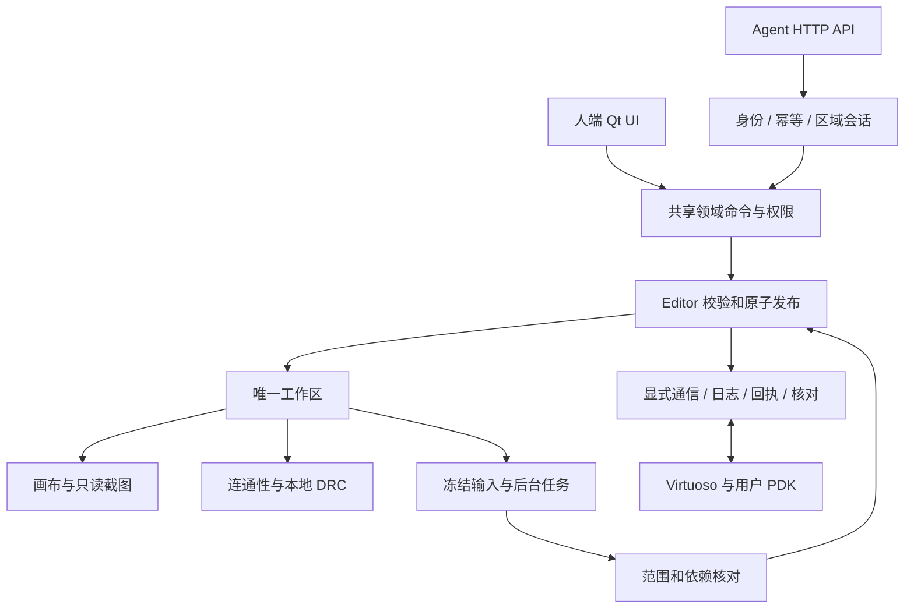

# 架构与维护边界

[English / 完整模块说明](../architecture.md) · [开发](../development.md)

三大接口（Windows UI、Agent HTTP API、Virtuoso 通信）共用唯一 Workspace、Editor 和 UID。只读后台快照服务于检查和显示，不是另一套可编辑版图。

## 必须保持的规则

- 本地操作区不创建 OA 子 cell；原生层次与本地层次是两套结构。普通叶 PCell 仍参与检查。
- 同层独占，父子与兄弟可分别接入。父只处理直接子区外框和公开接口，不越层进入内部。
- 本区 Agent 可调整自身边界、PIN 和模式。人可查看，定位框是占用期间有限的指导例外。
- 原生几何使用 DBU；API 通常使用工作区绝对微米。按实际技术单位转换。
- 接口 PIN 是接入义务，不是实体金属。同名标签、逻辑复制分组不构成物理连接。
- Qt 所属线程串行发布；后台采用前核对范围指纹、依赖和权限。无关兄弟区修改不应导致误失效。
- 自动保护保存在内部目录；手动保存才更新外部 JSON。读取存档不自动写入服务器。
- 本地 DRC 是简化检查，服务器 DRC 可独立启动；完成验收仍要求两类当前全区证据。区域通过不等于 LVS。
- UI、API 和服务器区域验收共用人端批准的过滤设置，原始报告保留。
- 原生结果未知时保留 pending、请求 ID 和回执，走对账；不能靠删记录或改状态重放。
- PDK 事实集中在统一配置包，有证据且经人审核；不能按某个工艺的层名或器件名猜测。

完整模块表、存储位置、并发模型、恢复协议与扩展规则见上方英文维护说明。源码注释和 API 描述保留各自适合的语言。
